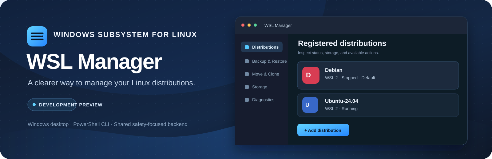

<div align="center">
  
  <h1>WSL Manager</h1>
  <p><strong>Manage Windows Subsystem for Linux from one clear, safety-focused workspace.</strong></p>
  <p>
    <a href="https://github.com/geekedctrl/wsl-management-tool/releases"></a>
    
    
  </p>
</div>

<p align="center">
  
</p>

> **Development preview — not production-validated.** Automated unit tests and read-only local checks pass, but live WSL install, backup, restore, move, and clone workflows have not been completed in an isolated test environment. Keep independent backups and review every operation before confirming it.

## Download for Windows

Download the **WSL Manager Setup x64** `.exe` from the [GitHub Releases page](https://github.com/geekedctrl/wsl-management-tool/releases). The per-user installer includes the desktop app, its PowerShell backend, and the .NET/Windows App SDK runtime. It does not install WSL or require administrator access.

The preview installer is currently unsigned. Windows may show an unknown-publisher or SmartScreen warning. Review the release notes and SHA-256 checksum before running it. Updates are installed manually from Releases.

For source, build instructions, and the PowerShell CLI, continue below. To install from a source checkout, see [Installation](docs/Installation.md).

## What it can do

- **Manage distributions:** list, inspect, start, terminate, set default, and convert when WSL supports the requested operation.
- **Add distributions:** search Microsoft's online catalog or import a local TAR/VHDX archive. When WSL advertises custom install names, install the same catalog image as another named registration, such as `Debian-Work`.
- **Back up and restore:** export selected distributions to TAR or supported VHDX, keep a checksum and manifest, and restore as a new registration.
- **Move and clone:** use native WSL move support when available; clone to a separate name and location while preserving the source.
- **Inspect storage and diagnostics:** view discoverable disk, filesystem, host-volume, WSL, and configuration information.
- **Save defaults:** configure separate per-user folders for diagnostics exports, WSL backups, and new distribution installations.

The desktop app is a native WinUI 3 client. The PowerShell terminal menu and CLI remain available and share the same backend services.

## Quick start

### Desktop app

1. Download the x64 Setup `.exe` from [Releases](https://github.com/geekedctrl/wsl-management-tool/releases).
2. Run Setup. It installs for the current Windows user and adds WSL Manager to the Start menu.
3. Open WSL Manager and use **Settings** to choose default export, backup, and installation folders.

WSL is required for distribution operations. The app will still open and show diagnostics if WSL is unavailable.

### PowerShell CLI

From a repository checkout, open PowerShell 5.1 or PowerShell 7 in the project directory:

```powershell
Set-ExecutionPolicy -Scope Process Bypass
./WSL-Manager.ps1
```

Run a direct command instead of the terminal menu with `-Action`:

```powershell
./WSL-Manager.ps1 -Action List
./WSL-Manager.ps1 -Action Info -Distro Debian
./WSL-Manager.ps1 -Action Diagnose -OutputFormat Json
./WSL-Manager.ps1 -Action Install -Distro Debian -NewName Debian-Work -Destination 'D:\WSL\Debian-Work' -WhatIf
./WSL-Manager.ps1 -Action Backup -Distro Debian -Destination 'D:\Backups' -Format Tar
./WSL-Manager.ps1 -Action Restore -Source 'D:\Backups\Debian.tar' -Distro Debian-Restored -Destination 'D:\WSL\Debian-Restored'
./WSL-Manager.ps1 -Action Clone -Distro Debian -NewName Debian-Test -Destination 'D:\WSL\Debian-Test'
```

See the complete [command reference](docs/Commands.md) for parameters, examples, and exit codes.

## Safety

- Existing distributions and destination folders are never overwritten automatically.
- Unregister permanently deletes a distribution and requires extra confirmation plus exact-name typing.
- Backups do not stop a running distribution automatically and are not claimed restorable until a test restore succeeds.
- Move uses native WSL support only; the app does not fall back to unregister/import migration.
- `-WhatIf` previews supported CLI modifications. `-Force` never bypasses safety checks.
- WSL Manager does not run `wsl --shutdown`, enable Windows features, modify global WSL configuration, or elevate itself automatically.

Read [Safety](docs/Safety.md) and [Compatibility](docs/Compatibility.md) before using data-changing features.

## Compatibility

- **PowerShell CLI:** Windows 10 and Windows 11 with a supported WSL installation; PowerShell 5.1 or PowerShell 7.
- **Desktop preview:** tested on Windows 11 x64. It targets .NET 10 and Windows App SDK 2.5.1. Windows 10 runtime behavior has not been verified; .NET 10 support on Windows 10 is limited to supported LTSC/Enterprise editions.
- WSL capabilities vary by installed release. Unsupported commands are reported instead of simulated.
- No third-party runtime dependencies are required by the CLI. The installer includes the desktop runtime; WSL remains a separate Microsoft prerequisite.

See the official [.NET on Windows support table](https://learn.microsoft.com/dotnet/core/install/windows), [Windows App SDK support matrix](https://learn.microsoft.com/windows/apps/windows-app-sdk/support), and [WSL command reference](https://learn.microsoft.com/windows/wsl/basic-commands).

## Build from source

The CLI runs directly in PowerShell. To build and launch the desktop app, install the .NET 10 SDK and use:

```powershell
dotnet restore WSLManager.Desktop.sln -p:Platform=x64
dotnet build WSLManager.Desktop.sln -p:Platform=x64
dotnet run --project src/WSLManager.Desktop/WSLManager.Desktop.csproj -p:Platform=x64
```

To build the self-contained per-user Setup `.exe`, install Inno Setup 7, then run:

```powershell
./scripts/Build-Installer.ps1
```

The setup file is written to `artifacts/installer/`. Build details and runtime notes are in [Installation](docs/Installation.md).

## Development

Run the PowerShell unit suite and desktop core tests:

```powershell
Install-Module Pester -Scope CurrentUser
Invoke-Pester ./tests/Unit
dotnet test tests/WSLManager.Desktop.Core.Tests/WSLManager.Desktop.Core.Tests.csproj -p:Platform=x64
```

Live data-changing WSL integration tests must use isolated, positively identified disposable distributions. See [Contributing](CONTRIBUTING.md) and [the integration test policy](tests/Integration/README.md).

## Project documents

- [Installation](docs/Installation.md)
- [Commands](docs/Commands.md)
- [Architecture](docs/Architecture.md)
- [Safety](docs/Safety.md)
- [Compatibility](docs/Compatibility.md)
- [Troubleshooting](docs/Troubleshooting.md)
- [Changelog](CHANGELOG.md)

## License

WSL Manager is released under the [MIT License](LICENSE). Some bundled distribution logos have separate usage terms; see [their attribution notes](src/WSLManager.Desktop/Assets/DistributionLogos/README.md).
